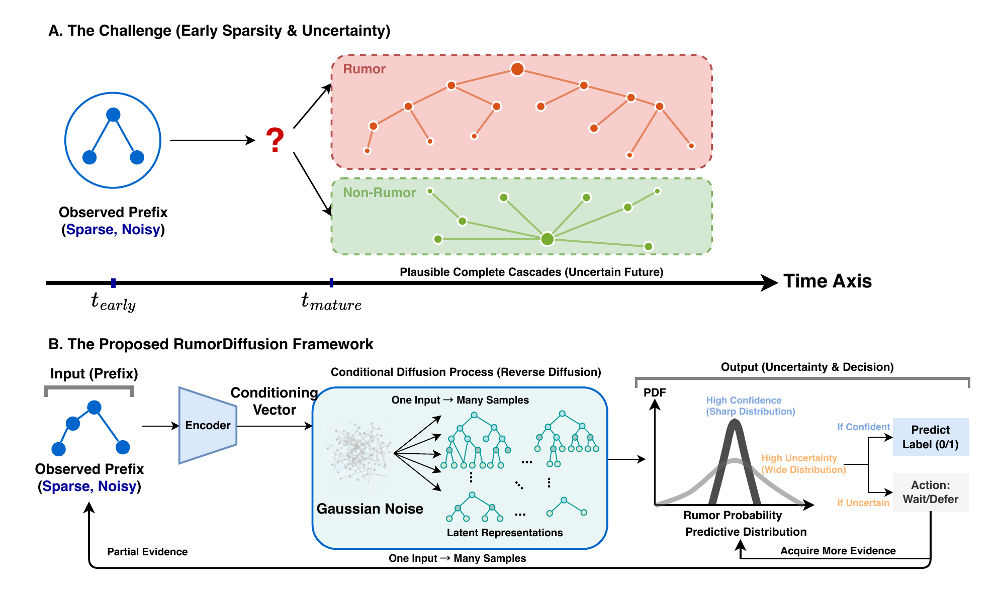
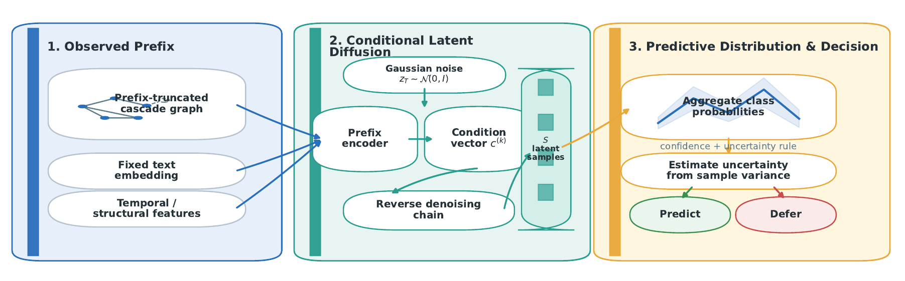
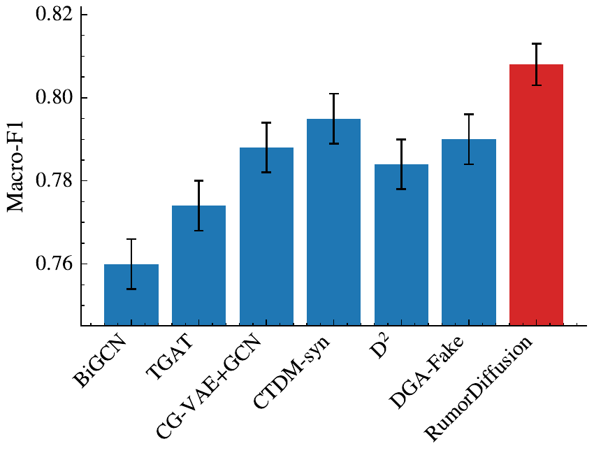
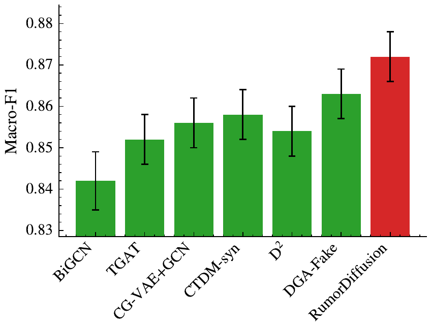
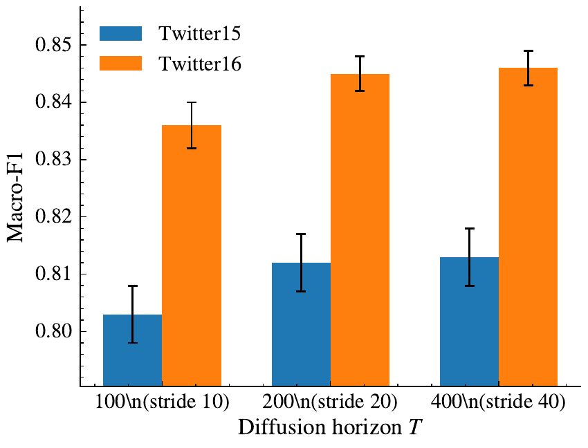
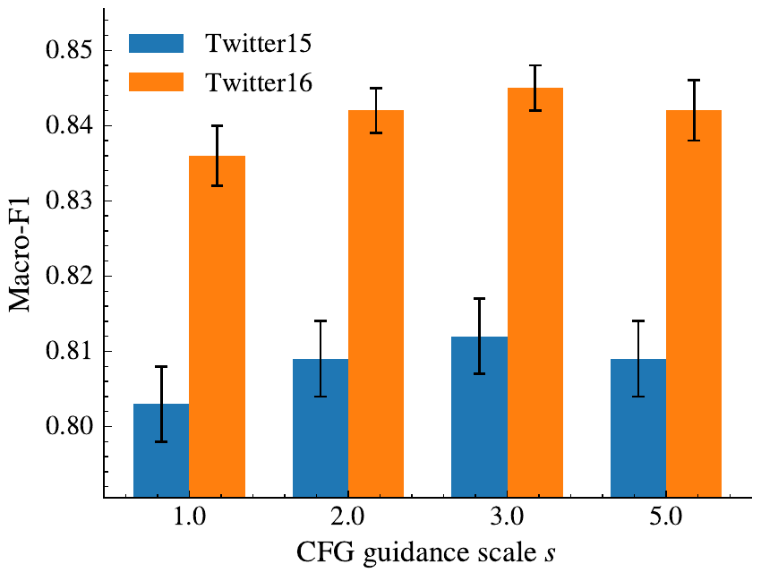
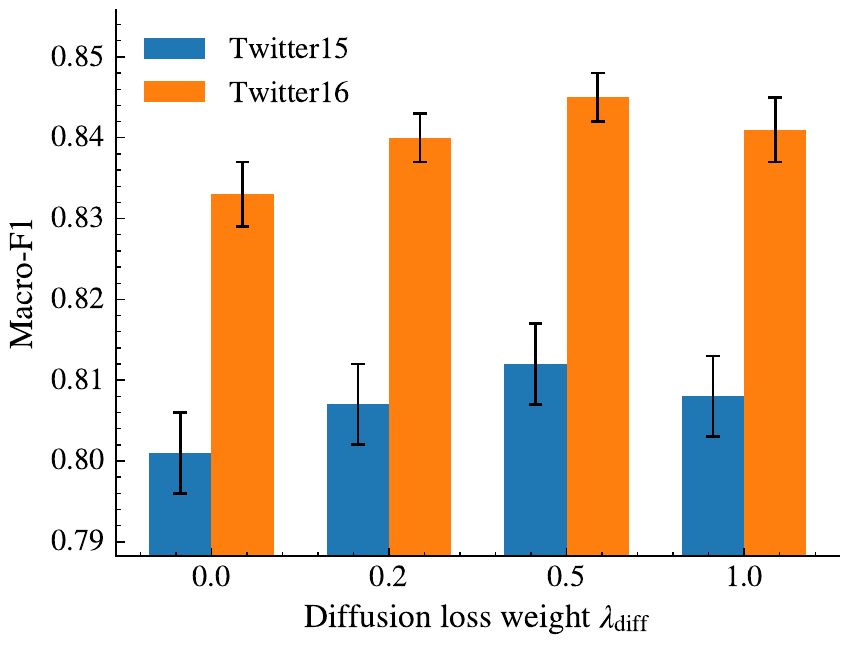

# RumorDiffusion: Prefix-Conditioned Diffusion for Early Rumor Detection Under Sparse and Incomplete Social Cascades

[](https://dl.acm.org/journal/tist)
[](https://dl.acm.org/)
[](https://www.python.org/)
[](https://pytorch.org/)

Official PyTorch and PyTorch Geometric (PyG) implementation, evaluation suite, and sample data for the **ACM Transactions on Intelligent Systems and Technology (ACM TIST / ACM T-TIST)** accepted paper:

> **Prefix-Conditioned Diffusion for Early Rumor Detection Under Sparse and Incomplete Social Cascades**  
> *Haowei Xu, Chao Gao\*, Xianghua Li, and Zhen Wang*  
> **Accepted in:** *ACM Transactions on Intelligent Systems and Technology (ACM TIST / ACM T-TIST)*  
> **Affiliations:** *School of Artificial Intelligence, Optics and Electronics (iOPEN) and School of Cybersecurity, Northwestern Polytechnical University, Xi'an, Shaanxi, P.R. China*  
> **Note:** *A preliminary version of this work (D²) was presented at the Eighteenth ACM International Conference on Web Search and Data Mining (WSDM 2025).*

---

## Overview

Early rumor detection (ERD) on social media platforms aims to verify the truthfulness of a newly emerging claim before it has widely propagated, enabling timely platform interventions such as warning labels, verification prioritization, or re-sharing friction. In real-world moderation workflows, early diffusion traces are sparse, noisy, and structurally incomplete due to delayed crowd feedback, platform application programming interface (API) limits, and deleted replies. Point-prediction classifiers and deterministic graph neural networks (GNNs) map a single truncated prefix directly to a single label score, implicitly treating unobserved future interactions as absent and often producing overconfident errors when the early prefix is compatible with multiple plausible future cascade developments.

<p align="center">
  
</p>

To address partial observability and decision timing under incomplete propagation evidence, **RumorDiffusion** reformulates early rumor detection as conditional posterior inference over latent complete-cascade states given an observed prefix. Rather than committing to a single imputed graph topology, RumorDiffusion couples a **Conditional Topological Diffusion Model (CTDM)** with a **Frozen-CTDM Transformer Arbiter** and a **Validation-Calibrated Uncertainty-Aware Deferral Policy**:

<p align="center">
  
</p>

1. **Early Detection as Conditional Posterior Inference:** Models the unobserved complete cascade through a compact latent representation and marginalizes over plausible future propagation states consistent with the observed early prefix.
2. **Prefix-Conditioned Topological Diffusion (`Libs/models/baselines/CTDM_syn.py`):** Learns a class-conditional reverse denoising process supervised by mature training cascades and observed prefixes, generating class-conditioned latent potential vectors from prefix observations at inference time via classifier-free guidance (CFG) without accessing future test interactions.
3. **Frozen-CTDM Transformer Arbiter (`Libs/models/baselines/RumorDiffusion.py`):** Aggregates class-conditioned potential vectors and confusable-pair difference tokens into veracity probabilities using logit-adjusted focal classification, pairwise margin constraints, Brier score regularization, and multi-prefix simulation consistency.
4. **Uncertainty-Aware Sequential Decision Making (`Libs/utils/calibration.py`, `Libs/utils/selective_metrics.py`):** Approximates the posterior predictive mean and completion-disagreement variance across repeated reverse diffusion trajectories, combining post-hoc validation temperature scaling with a joint confidence-and-variance stopping rule to balance decision accuracy and intervention latency.

---

## Methodology

### 1. Predictive Distribution via Prefix-Conditioned Latent Simulation

Let $o_k$ denote the social cascade prefix observed at early window $k$ (measured in elapsed minutes on timestamped streams or structural hop depth on tree-structured cascades), and let $\mathbf{c}^{(k)}$ denote its encoded prefix condition vector produced by the prefix encoder $f_{\mathrm{pre}}$. Rather than mapping $o_k$ to a single deterministic point estimate, RumorDiffusion introduces a latent state $\mathbf{x}_0$ representing the mature cascade and marginalizes the veracity prediction $y \in \lbrace 0, 1, \dots, C-1 \rbrace$ over the conditional distribution of plausible completions:

$$
\mathbf{c}^{(k)} = f_{\mathrm{pre}}(o_k), \qquad p(y \mid o_k) = \int p_\phi(y \mid \mathbf{x}_0, o_k) p_\theta(\mathbf{x}_0 \mid \mathbf{c}^{(k)}) d\mathbf{x}_0
$$

where $y$ is the cascade veracity label over $C$ classes, $o_k$ is the observed prefix at window $k$, $\mathbf{c}^{(k)}$ is the prefix condition vector, $f_{\mathrm{pre}}$ is the prefix encoder, $\mathbf{x}_0$ is the latent state of the complete cascade, $p_\theta$ is the conditional diffusion distribution parameterized by generator weights $\theta$, and $p_\phi$ is the discriminative predictive distribution parameterized by arbiter weights $\phi$.

### 2. Prefix Graph Encoding and Masked Attentive Pooling

Given the observed prefix graph $G^{(k)} = (V^{(k)}, E^{(k)})$ with recomputed structural and temporal node attributes $X^{(k)}$ (normalized time since the root post, tree depth, in-degree, out-degree, and normalized parent-child time gap), a residual message-passing backbone $\mathrm{GEnc}$ contextualizes node representations and pools them over the visible node mask:

$$
\mathbf{g}_j = \mathrm{GEnc}(G^{(k)}, X^{(k)})_j, \qquad \alpha_j^{(k)} = \frac{m_j^{(k)} \exp\left(\mathbf{q}^\top \mathbf{g}_j\right)}{\sum_{\ell=1}^{M} m_\ell^{(k)} \exp\left(\mathbf{q}^\top \mathbf{g}_\ell\right)}, \qquad \mathbf{h}^{(k)} = \sum_{j=1}^{M} \alpha_j^{(k)} \mathbf{g}_j
$$

where $j, \ell \in \lbrace 1, \dots, M \rbrace$ index the $M$ candidate cascade nodes, $\mathbf{g}_j$ is the contextualized graph representation of node $j$ of dimension $D$, $m_j^{(k)} \in \lbrace 0, 1 \rbrace$ is the binary observability mask indicating whether node $j$ belongs to the root-connected prefix at window $k$, $\mathbf{q} \in \mathbb{R}^{D}$ is a learnable attention query vector, $\alpha_j^{(k)}$ is the normalized attention weight of node $j$, and $\mathbf{h}^{(k)} \in \mathbb{R}^{D}$ is the pooled cascade representation at window $k$.

### 3. Conditional Topological Diffusion Model (CTDM)

During stage-one pretraining, mature training cascades supply the complete topology-and-feature state $\mathbf{x}_0$ constructed from the full training adjacency matrix $A_{\mathrm{full}}$ and full node feature matrix $X_{\mathrm{full}}$. A Gaussian forward diffusion process of $T$ steps perturbs $\mathbf{x}_0$ according to the variance schedule $\beta_1$, $\dots$, $\beta_T$ as follows:

$$
q(\mathbf{x}_t \mid \mathbf{x}_0) = \mathcal{N}\left(\sqrt{\bar{\alpha}_t}\mathbf{x}_0, (1 - \bar{\alpha}_t)\mathbf{I}\right), \quad \mathbf{x}_t = \sqrt{\bar{\alpha}_t}\mathbf{x}_0 + \sqrt{1 - \bar{\alpha}_t}\epsilon, \quad \alpha_t = 1 - \beta_t, \quad \bar{\alpha}_t = \prod_{r=1}^{t} \alpha_r
$$

where $t \in \lbrace 1, \dots, T \rbrace$ is the diffusion timestep, $\beta_t \in (0, 1)$ is the step variance, $\alpha_t$ is the per-step signal retention factor, $\bar{\alpha}_t$ is the cumulative signal retention factor, $\mathbf{I}$ is the identity matrix, $\epsilon$ is standard Gaussian noise, and $\mathbf{x}_t$ is the noisy cascade state at step $t$. Using the velocity-parameterized denoiser $v_\theta$ conditioned on class hypothesis $y$ and observed prefix state $\mathbf{x}_{\mathrm{obs}}$, the diffusion training loss and reverse observation-anchoring update are:

$$
\mathcal{L}_{\mathrm{diff}} = \mathbb{E}_{t, \epsilon} \left[ \left\Vert v_\theta(\mathbf{x}_t, t, y, \mathbf{x}_{\mathrm{obs}}) - \left(\sqrt{\bar{\alpha}_t}\epsilon - \sqrt{1 - \bar{\alpha}_t}\mathbf{x}_0\right) \right\Vert_2^2 \right]
$$

$$
\mathbf{x} \leftarrow (1 - M_{\mathrm{obs}}) \odot \mathbf{x} + M_{\mathrm{obs}} \odot \mathbf{x}_{\mathrm{obs}}
$$

where $\mathbf{x}_{\mathrm{obs}}$ is the observed prefix state, $v_\theta$ is the neural velocity predictor, $\Vert \cdot \Vert_2$ denotes the Euclidean norm, $M_{\mathrm{obs}}$ is the binary observation mask, and $\odot$ denotes element-wise multiplication. During reverse inference with stride $\Delta t$ and classifier-free guidance scale $w$, the denoised state is re-encoded with the fixed source-post sentence embedding to produce one potential vector $\mathbf{h}_c^{(s)}$ per class hypothesis $c \in \lbrace 0, \dots, C-1 \rbrace$ for draw $s$.

### 4. Frozen-CTDM Transformer Arbiter

In stage two, CTDM parameters $\theta^\star$ are frozen and the Transformer arbiter $A_\phi$ maps the class-conditioned potential set $H^{(s)}$ (augmented with confusable-pair difference tokens) to class logits $\mathbf{z}_k^{(s)}$ as follows:

$$
H^{(s)} = \left[\mathbf{h}_0^{(s)}, \dots, \mathbf{h}_{C-1}^{(s)}\right], \qquad \mathbf{z}_k^{(s)} = A_\phi\left(H^{(s)}, o_k\right)
$$

$$
\phi^\star = \arg\min_\phi \left( \mathcal{L}_{\mathrm{cls}} + \mathcal{L}_{\mathrm{pair}} + \lambda_{\mathrm{Brier}} \mathcal{L}_{\mathrm{Brier}} + \lambda_{\mathrm{cons}} \mathcal{L}_{\mathrm{cons}} \right)
$$

where $\mathcal{L}_{\mathrm{cls}}$ is the logit-adjusted focal classification loss, $\mathcal{L}_{\mathrm{pair}}$ combines pairwise and multi-pair margin losses with binary cross-entropy on the confusable-pair head, $\mathcal{L}_{\mathrm{Brier}}$ is the Brier calibration penalty weighted by $\lambda_{\mathrm{Brier}}$, and $\mathcal{L}_{\mathrm{cons}}$ is the symmetric Kullback-Leibler consistency loss aligning predictions across multiple prefix horizons weighted by $\lambda_{\mathrm{cons}}$.

### 5. Calibration and Uncertainty-Aware Early Stopping

Given $S$ stochastic reverse-diffusion draws at prefix window $k$ and a scalar temperature $T_{\mathrm{cal}} > 0$ fitted on validation logits, RumorDiffusion computes calibrated draw probabilities $p_k^{(s)}$, predictive mean $\bar{p}_k$, and completion-disagreement variance $u_k$ as follows:

$$
p_k^{(s)} = \mathrm{softmax}\left(\frac{\mathbf{z}_k^{(s)}}{T_{\mathrm{cal}}}\right), \qquad \bar{p}_k(c) = \frac{1}{S} \sum_{s=1}^{S} p_k^{(s)}(c), \qquad c^\star = \arg\max_{c} \bar{p}_k(c), \qquad u_k = \frac{1}{S} \sum_{s=1}^{S} \left( p_k^{(s)}(c^\star) - \bar{p}_k(c^\star) \right)^2
$$

where $s \in \lbrace 1, \dots, S \rbrace$ indexes the stochastic diffusion trajectories, $p_k^{(s)}(c)$ is the calibrated probability of class $c$ in draw $s$, $\bar{p}_k(c)$ is the posterior predictive mean probability for class $c$, $c^\star$ is the top-scoring predicted class, and $u_k$ is the empirical variance across draws for $c^\star$. The uncertainty-stabilized decision policy accepts $c^\star$ at window $k$ if confidence $\bar{p}_k(c^\star) \ge \tau$ and disagreement $u_k \le \gamma$ (where $\tau$ and $\gamma$ are validation-selected confidence and variance thresholds), and defers with action $\bot$ to acquire further propagation evidence otherwise.

---

## Repository Structure

```text
RumorDiffusion/
├── README.md                                 # Repository documentation and reproduction guide
├── requirements.txt                          # Python package dependencies
├── pyproject.toml                            # Project metadata and pytest configuration
├── Docs/
│   └── assets/                               # Framework diagrams and experimental result plots
├── Input/
│   ├── sample/                               # Ready-to-run stratified sample data (32 cascades/dataset)
│   │   ├── raw/                              # Raw sample trees and JSON cascades (twitter15/16, weibo, pheme)
│   │   ├── processed/                        # Processed PyG tensors, splits, LP edges, and cached embeddings
│   │   └── sample_manifest.json              # Sample dataset summary and split source IDs
│   ├── raw/                                  # Sample raw cascade files and full-dataset label/tweet tables
│   ├── processed_paper_aligned/              # Benchmark split definitions and label schemas (paper_aligned)
│   └── processed_canonical_v1/               # Canonical split/raw/processed provenance manifests
├── Libs/
│   ├── configs/                              # Experiment, dataset, and model YAML configurations
│   │   ├── baselines/                        # RumorDiffusion, 19 baselines, ablations, and sweep YAMLs
│   │   ├── model_canonical/                  # Canonical frozen-CTDM RumorDiffusion specification
│   │   ├── dataset.yaml                      # Full paper-aligned dataset preprocessing configuration
│   │   ├── dataset_canonical.yaml            # Canonical dataset preprocessing configuration
│   │   ├── dataset_sample.yaml               # Bundled sample dataset preprocessing configuration
│   │   ├── exp_paper_ready.yaml              # Five-seed paper-aligned benchmark configuration
│   │   ├── exp_canonical.yaml                # Canonical prediction-first pipeline configuration
│   │   ├── exp_sample.yaml                   # Out-of-the-box sample training and evaluation configuration
│   │   └── exp_smoke.yaml                    # Quick smoke-test configuration
│   ├── data/
│   │   ├── processor.py                      # Raw cascade parsing, prefix feature extraction, and manifest builder
│   │   ├── dataset.py                        # PyG GraphDataset with dynamic prefix truncation and missingness
│   │   ├── potential_cache.py                # Validated CTDM class-potential cache loader
│   │   └── d2.py                             # Data pipeline for the D² conference baseline
│   ├── models/
│   │   ├── baselines/                        # RumorDiffusion, CTDM_syn, BiGCN, TGAT, DGAFake, HPCLCascade, etc.
│   │   └── modules/                          # Core diffusion denoiser and root-aware cascade modules
│   ├── exp/
│   │   ├── run.py                            # Unified training, calibration, early-stop, and transfer runner
│   │   ├── trainer.py                        # Discriminative baseline and arbiter training loops
│   │   ├── rumordiffusion_explain.py         # Per-cascade decision trace and token statistics exporter
│   │   ├── explain_summary.py                # Qualitative case-study selector and summary builder
│   │   ├── analyze_dataset.py                # Dataset statistics and cascade structural profiler
│   │   ├── analyze_transfer_shift.py         # Cross-domain structural and semantic shift analyzer
│   │   └── aggregate_results.py              # Multi-seed confidence interval and paired bootstrap aggregator
│   ├── scripts/                              # SLURM benchmark launchers and paper asset generators
│   └── utils/                                # Metrics (Macro-F1, ECE), temperature scaling, and schema validators
├── Output/
│   └── results/
│       └── paper_aligned/                    # Paper-aligned multi-seed CSV summaries and case-study JSONs
├── schemas/                                  # JSON schemas for run manifests, predictions, and metrics
└── tests/                                    # Unit and integration tests for leakage, splits, metrics, and schemas
```

---

## Benchmarks and Bundled Sample Data

### 1. Evaluated Benchmarks

We evaluate RumorDiffusion across four public social media rumor benchmarks spanning four-way veracity classification (`Twitter15`, `Twitter16`) and binary rumor detection (`Weibo`, `PHEME`):

| Dataset | Platform / Language | Task | Label Space | Cascades | Early Observation Windows | Main Window |
| --- | --- | --- | --- | --- | --- | --- |
| **Twitter15** | Twitter (English) | 4-way veracity | Non-Rumor (NR), True, False, Unverified | 1,490 | 10, 20, 30 minutes | 60 minutes |
| **Twitter16** | Twitter (English) | 4-way veracity | Non-Rumor (NR), True, False, Unverified | 818 | 10, 20, 30 minutes | 60 minutes |
| **Weibo** | Sina Weibo (Chinese) | Binary detection | Non-Rumor, Rumor | 4,664 | 1, 2, 3 hops | 3 hops |
| **PHEME** | Twitter (English) | Binary detection | Non-Rumor, Rumor | 5,802 | 1, 2, 3 hops | 3 hops |

### 2. Bundled Sample Data (`Input/sample/` and `Input/raw/`)

To allow immediate verification of preprocessing, two-stage CTDM + Arbiter training, post-hoc temperature calibration, early-window deferral, and baseline comparisons without downloading multi-hundred-megabyte external archives first, this repository includes a complete, stratified **Sample Dataset (`Input/sample/`)** sliced directly from the real benchmarks:

- **`Input/sample/raw/{twitter15,twitter16,weibo,pheme}/`:** 32 real cascades per dataset (128 cascades in total: 16 training, 8 validation, and 8 test cascades per dataset, balanced equally across all veracity classes), including `label.txt`, `source_tweets.txt`, and `tree/<source_id>.txt` for Twitter15/16, and `<source_id>.json` for Weibo/PHEME. Representative raw cascade files are also included under `Input/raw/`.
- **`Input/sample/processed/{twitter15,twitter16,weibo,pheme}/`:** Pre-built PyG `InMemoryDataset` tensors (`pyg/data.pt`, `pyg/slices.pt`), cascade splits (`splits.json`), link-prediction edges (`lp_edges/*.pt`), pre-extracted 768-D MPNet (`text_embs_mpnet_canonical_v1.pt`, `text_embs_mpnet_paper_ready.pt`) and 384-D MiniLM (`text_embs.pt`) sentence embeddings, and hash-verified canonical manifests (`raw_manifest.json`, `processed_manifest.json`, `split_manifest.json`, `label_schema.json`).
- **`Input/processed_paper_aligned/` and `Input/processed_canonical_v1/`:** Full-benchmark split indices (`splits.json`) and canonical provenance manifests for all 12,711 processed cascades.

### 3. Full Dataset and Pretrained Text Encoder Download

To reproduce the full-scale benchmark experiments across all 12,711 cascades, download the complete archive (raw datasets, processed PyG datasets, and local Sentence-Transformer weights) from [Google Drive](https://drive.google.com/file/d/1rSFOLfTwe-TWrCEIPfYK7j4X_kosaX28/view?usp=sharing) and extract it into `Input/`:

- `Input/raw/{twitter15,twitter16,weibo,pheme}/` — Full raw cascade trees and JSON streams.
- `Input/processed_paper_aligned/{twitter15,twitter16,weibo,pheme}/` — Full paper-aligned PyG tensors and cached sentence embeddings.
- `Input/sentence_transformers_all_MiniLM_L6v2/` and `Input/sentence_transformers_all_mpnet_base_v2/` — Local pretrained Sentence-Transformer checkpoints.

---

## Installation

1. Clone this repository:
   ```bash
   git clone https://github.com/HowieHsu0126/RumorDiffusion.git
   cd RumorDiffusion
   ```

2. Create a Python 3.10+ environment and install PyTorch and PyTorch Geometric matching your CPU or CUDA setup, followed by the remaining dependencies:
   ```bash
   pip install -r requirements.txt
   ```

---

## Quick Start (Using Bundled Sample Data)

You can run the complete **RumorDiffusion** two-stage training, validation temperature scaling, main evaluation, and 10/20/30-minute early-stopping pipeline immediately on the bundled sample data (`Input/sample/`):

```bash
# Train and evaluate canonical RumorDiffusion on the bundled Twitter15 sample data
python -m Libs.exp.run \
  --exp Libs/configs/exp_sample.yaml \
  --model Libs/configs/model_canonical/rumordiffusion.yaml

# Run on another bundled sample dataset (twitter16, weibo, or pheme)
python -m Libs.exp.run \
  --exp Libs/configs/exp_sample.yaml \
  --model Libs/configs/model_canonical/rumordiffusion.yaml \
  --dataset_override pheme

# Compare against discriminative and contrastive baselines on the sample data
python -m Libs.exp.run \
  --exp Libs/configs/exp_sample.yaml \
  --model Libs/configs/baselines/hpcl_cascade.yaml,Libs/configs/baselines/bigcn.yaml,Libs/configs/baselines/tgat.yaml

# Verify canonical input manifests and split integrity on the sample data
python -m Libs.data.processor \
  --config Libs/configs/dataset_sample.yaml \
  --dataset twitter15 \
  --regen_splits_only

# Run the unit and schema validation test suite
pytest -q tests
```

---

## Full Benchmark Training and Evaluation

### 1. Preprocessing Full Raw Cascades

After extracting the full raw datasets into `Input/raw/`, generate the paper-aligned PyG datasets:

```bash
python -m Libs.data.processor \
  --config Libs/configs/dataset.yaml \
  --dataset twitter15
```

Or prepare the strict manifest-verified canonical inputs across all four datasets:

```bash
export RUMORDIFFUSION_PROCESSED_ROOT="$PWD/Input/processed_canonical_v1"
export RUMORDIFFUSION_TEXT_ENCODER="$PWD/Input/sentence_transformers_all_mpnet_base_v2"

python -m Libs.scripts.prepare_canonical_inputs \
  --exp Libs/configs/exp_canonical.yaml \
  --dataset-config Libs/configs/dataset_canonical.yaml
```

### 2. Running Full 5-Seed Paper-Aligned Experiments

Run RumorDiffusion or any of the 19 baseline configurations (`textonly`, `gcn`, `gat`, `gatv2`, `sage`, `appnp`, `gcn2`, `resgcn`, `root_pool`, `bigcn`, `tgat`, `temporal_gcn`, `lp_gcn`, `d2_forecast_nas`, `ctdm_syn`, `cgvae_gcn`, `dga_fake`, `agad`, `hpcl_cascade`, `tpso`):

```bash
# Full 5-seed paper-ready training and evaluation (seeds: 42, 3407, 126, 218, 91)
python -m Libs.exp.run \
  --exp Libs/configs/exp_paper_ready_mpnet.yaml \
  --model Libs/configs/baselines/rumordiffusion.yaml \
  --dataset_override twitter16

# Evaluate a saved checkpoint only
python -m Libs.exp.run \
  --exp Libs/configs/exp_paper_ready_mpnet.yaml \
  --model Libs/configs/baselines/rumordiffusion.yaml \
  --eval_only \
  --ckpt Output/ckpts/paper_aligned/twitter16/rumordiffusion/seed42/best.pt
```

If running on a SLURM cluster, helper scripts in `Libs/scripts/` automate benchmark, ablation, hyperparameter sensitivity, transfer, and explainability runs:

```bash
sbatch Libs/scripts/run_bench_twitter15.sh
sbatch Libs/scripts/run_bench_twitter16.sh
sbatch Libs/scripts/run_bench_weibo.sh
sbatch Libs/scripts/run_bench_pheme.sh
sbatch Libs/scripts/run_rumordiffusion_ablation.sh
sbatch Libs/scripts/run_rumordiffusion_hparam.sh
sbatch Libs/scripts/run_transfer.sh
```

### 3. Interpretability and Decision-Trace Export

Export per-cascade probabilities, completion variances, and sequential early-stopping decision traces:

```bash
python -m Libs.exp.rumordiffusion_explain \
  --exp Libs/configs/exp_paper_ready_mpnet.yaml \
  --model Libs/configs/baselines/rumordiffusion.yaml \
  --ckpt Output/ckpts/paper_aligned/twitter16/rumordiffusion/seed42/best.pt \
  --split test \
  --out Output/explain/twitter16_rd.jsonl

python -m Libs.exp.explain_summary \
  --input Output/explain/twitter16_rd.jsonl \
  --out Output/explain/twitter16_rd_summary.csv \
  --topk 20
```

---

## Experimental Results

All paper-aligned multi-seed result tables are included under [`Output/results/paper_aligned/`](Output/results/paper_aligned/).

### 1. Main Observed-Prefix Results (5 Runs, Mean ± 95% CI)

Under the shared observed-prefix protocol (60 minutes on Twitter15/16 and 3 hops on Weibo/PHEME), **RumorDiffusion** achieves strong classification accuracy and Macro-F1 across all four benchmarks while outperforming graph-only and generative baselines (`BiGCN`, `TGAT`, `LP-GCN`, `AGAD`, `TPSO`, and `DGA-Fake` on Twitter16/PHEME):

| Method | Twitter15 Acc | Twitter15 Macro-F1 | Twitter16 Acc | Twitter16 Macro-F1 | Weibo Acc | Weibo Macro-F1 | PHEME Acc | PHEME Macro-F1 |
| --- | :---: | :---: | :---: | :---: | :---: | :---: | :---: | :---: |
| **TextOnly (Sentence Emb.)** | 0.759±0.003 | 0.748±0.004 | 0.793±0.014 | 0.791±0.015 | 0.794±0.005 | 0.794±0.005 | **0.856±0.007** | **0.844±0.008** |
| **BiGCN** | 0.420±0.023 | 0.399±0.027 | 0.393±0.050 | 0.360±0.053 | 0.832±0.007 | 0.832±0.007 | 0.610±0.013 | 0.492±0.022 |
| **TGAT** | 0.433±0.036 | 0.412±0.046 | 0.384±0.024 | 0.351±0.027 | 0.837±0.004 | 0.837±0.004 | 0.621±0.002 | 0.493±0.023 |
| **LP-GCN (D²)** | 0.388±0.017 | 0.367±0.025 | 0.428±0.021 | 0.389±0.026 | 0.842±0.004 | 0.842±0.004 | 0.624±0.010 | 0.446±0.040 |
| **DGA-Fake** | 0.775±0.000 | 0.774±0.002 | 0.744±0.025 | 0.743±0.024 | **0.887±0.007** | **0.887±0.008** | 0.816±0.004 | 0.799±0.005 |
| **AGAD** | 0.340±0.067 | 0.262±0.101 | 0.327±0.032 | 0.305±0.056 | 0.836±0.009 | 0.836±0.009 | 0.623±0.002 | 0.474±0.032 |
| **HPCL-cascade** | **0.808±0.018** | **0.802±0.021** | **0.819±0.009** | **0.817±0.009** | 0.876±0.004 | 0.876±0.004 | 0.849±0.006 | 0.837±0.006 |
| **TPSO** | 0.385±0.021 | 0.346±0.015 | 0.320±0.052 | 0.260±0.062 | 0.838±0.006 | 0.838±0.006 | 0.627±0.005 | 0.444±0.040 |
| **RumorDiffusion (Ours)** | 0.738±0.031 | 0.733±0.029 | 0.786±0.027 | 0.785±0.027 | 0.855±0.015 | 0.855±0.015 | 0.819±0.008 | 0.803±0.008 |

### 2. Zero-Shot Cross-Dataset Transfer and Calibration Reliability

Under strict source-only transfer (no target-domain fine-tuning or target-label threshold selection), **RumorDiffusion** achieves the lowest Expected Calibration Error (ECE) on both intra-lingual (`Twitter15 → Twitter16`) and cross-lingual (`Weibo → PHEME`) transfer pairs:

| Transfer Pair | Method | Source Macro-F1 | Transfer Macro-F1 | Macro-F1 Retained | Transfer ECE ↓ |
| --- | --- | :---: | :---: | :---: | :---: |
| **Twitter15 → Twitter16** | AGAD | 0.262±0.101 | 0.184±0.139 | 67.4±29.4% | 0.192±0.068 |
| **Twitter15 → Twitter16** | HPCL-cascade | **0.802±0.021** | **0.543±0.020** | **67.8±2.8%** | 0.391±0.015 |
| **Twitter15 → Twitter16** | TPSO | 0.346±0.015 | 0.215±0.143 | 61.5±39.1% | 0.222±0.025 |
| **Twitter15 → Twitter16** | **RumorDiffusion (Ours)** | 0.733±0.029 | 0.453±0.030 | 62.0±5.1% | **0.123±0.017** |
| **Weibo → PHEME** | AGAD | 0.836±0.009 | 0.471±0.007 | 56.3±1.4% | 0.473±0.016 |
| **Weibo → PHEME** | HPCL-cascade | **0.876±0.004** | **0.510±0.014** | **58.2±1.8%** | 0.361±0.010 |
| **Weibo → PHEME** | TPSO | 0.838±0.006 | 0.480±0.004 | 57.2±0.5% | 0.437±0.010 |
| **Weibo → PHEME** | **RumorDiffusion (Ours)** | 0.855±0.015 | 0.478±0.136 | 55.9±15.9% | **0.148±0.076** |

<p align="center">
  
  
</p>

### 3. Hyperparameter Sensitivity Analysis

Sensitivity sweeps across diffusion horizon $T \in \lbrace 100, 200, 400 \rbrace$, classifier-free guidance scale $s \in \lbrace 1, 2, 3, 5 \rbrace$, and diffusion coupling weight confirm stable performance around the canonical operating point of $T = 200$, stride $20$, and guidance scale $w = 3.0$ as shown below:

<p align="center">
  
  
  
</p>

---

## Citation

If you find **RumorDiffusion** or this repository useful in your research, please cite our **ACM TIST (ACM T-TIST)** paper and our preliminary **WSDM 2025** conference paper:

```bibtex
@article{xu2026rumordiffusion,
  author  = {Xu, Haowei and Gao, Chao and Li, Xianghua and Wang, Zhen},
  title   = {Prefix-Conditioned Diffusion for Early Rumor Detection Under Sparse and Incomplete Social Cascades},
  journal = {ACM Transactions on Intelligent Systems and Technology (TIST)},
  year    = {2026},
  note    = {Accepted for publication}
}

@inproceedings{xu2025d2,
  author    = {Xu, Haowei and Gao, Chao and Li, Xianghua and Wang, Zhen},
  title     = {Early Rumor Detection Based on Cascade Diffusion Prediction Models},
  booktitle = {Proceedings of the Eighteenth ACM International Conference on Web Search and Data Mining (WSDM '25)},
  year      = {2025}
}
```

---

## Acknowledgements and Contact

This work was supported in part by the National Natural Science Foundation of China (Nos. 62471403, 62271411, U22A2098, U22B2036), the Technological Innovation Team of Shaanxi Province (No. 2025RS-CXTD-009), the International Cooperation Project of Shaanxi Province (No. 2025GH-YBXM-017), the Fundamental Research Funds for the Central Universities (No. G2024WD0151), and the XPLORER PRIZE.

For questions regarding the code or paper, please contact **Haowei Xu** (`haoweixu@stu.pku.edu.cn`) or **Prof. Chao Gao** (`cgao@nwpu.edu.cn`).
